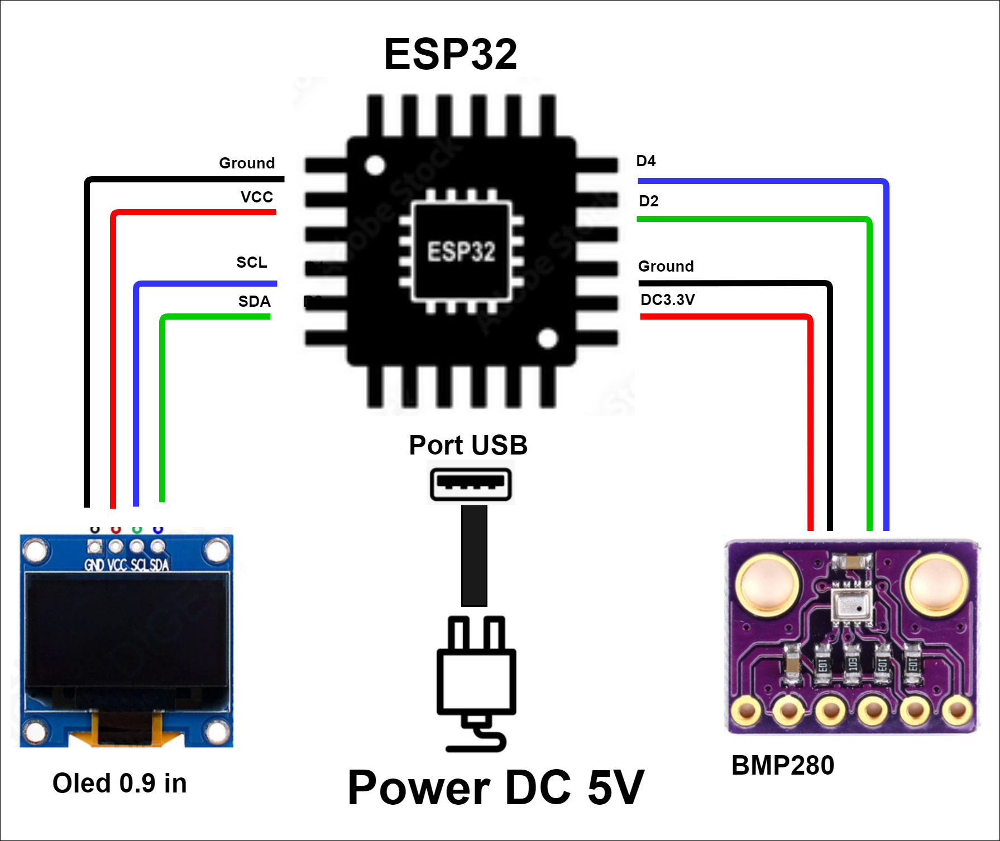
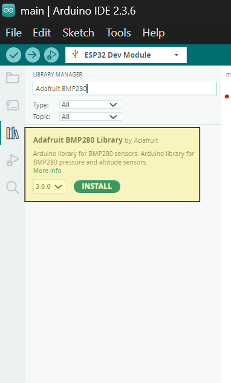
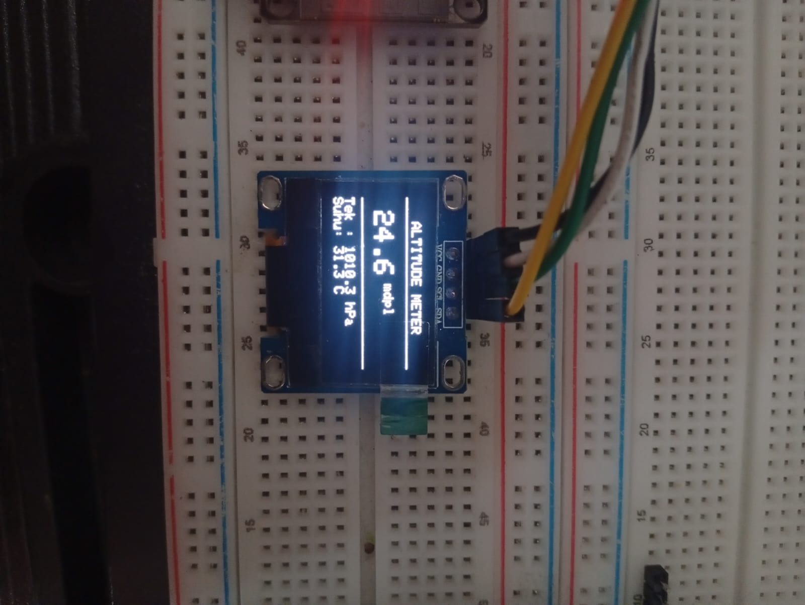
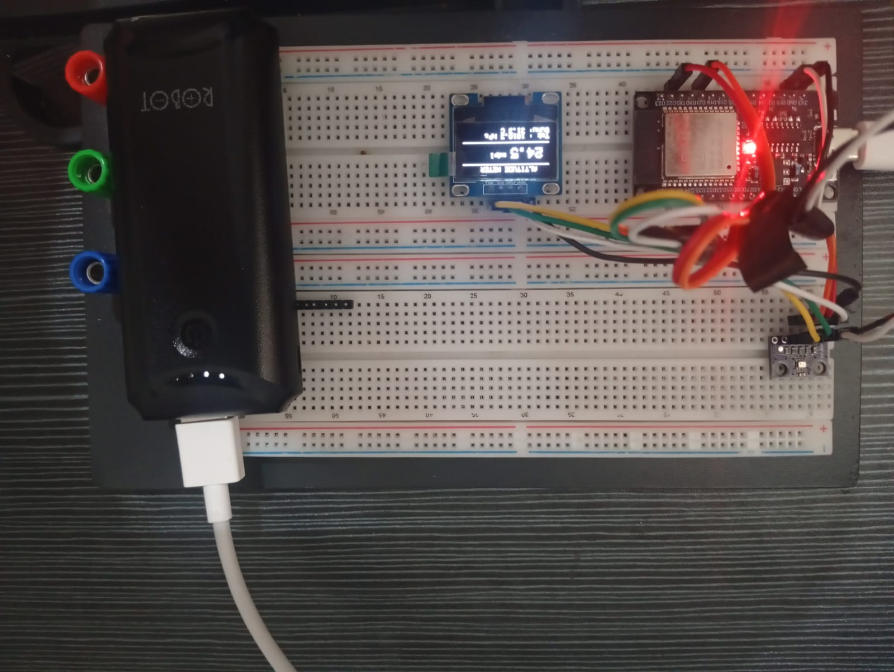
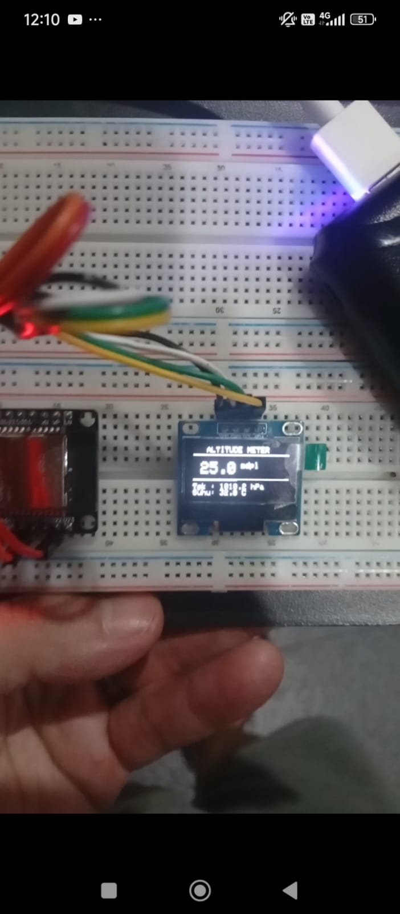
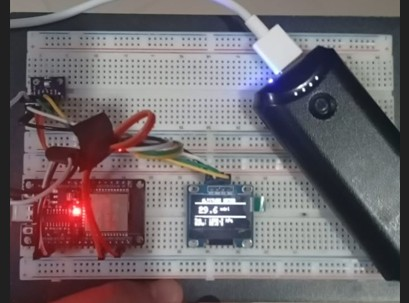

# MDPL Altitude Meter (Measuring Height Above Sea Level)

Have you ever wondered how high you really are above the ocean, even when you are miles inland? That is where **MDPL** comes in. 

MDPL means **"Meter Di Atas Permukaan Laut"** (in English: **Meters Above Sea Level**). It is the universal language of elevation, telling us exactly how high a location sits relative to the world's oceans, which act as our baseline at **0 meters**. While a rolling hill might sit comfortably at 100 mdpl, a towering mountain peak climbs past 1,000 mdpl and beyond. 

Though we cannot see elevation with our naked eyes, our environment leaves invisible clues. The secret lies in the air around us: higher altitudes mean thinner air and lower pressure, while staying low to the ground means bearing the weight of the atmosphere. By listening to these invisible shifts in air pressure, our tiny device can pinpoint exactly where we stand.

## Table of Contents

- [MDPL Altitude Meter (Measuring Height Above Sea Level)](#mdpl-altitude-meter-measuring-height-above-sea-level)
  - [Table of Contents](#table-of-contents)
  - [1. Introduction](#1-introduction)
    - [1.1 What is MDPL?](#11-what-is-mdpl)
    - [1.2 Why This Project?](#12-why-this-project)
  - [2. The Story of Air Pressure and Gravity](#2-the-story-of-air-pressure-and-gravity)
    - [2.1 Story 1 — Air Pressure and Gravity Make It Stronger](#21-story-1--air-pressure-and-gravity-make-it-stronger)
    - [2.2 Story 2 — Air Temperature Near The Ground Is Bigger](#22-story-2--air-temperature-near-the-ground-is-bigger)
  - [3. System Architecture](#3-system-architecture)
    - [3.1 Architecture Image](#31-architecture-image)
    - [3.2 Explanation of Every Component](#32-explanation-of-every-component)
    - [3.3 Wiring Map](#33-wiring-map)
    - [3.4 How Data Flows](#34-how-data-flows)
  - [4. Evidence and Test Results](#4-evidence-and-test-results)
    - [4.1 Installing The Adafruit BMP280 Library](#41-installing-the-adafruit-bmp280-library)
    - [4.2 Close Look at The OLED Display](#42-close-look-at-the-oled-display)
    - [4.3 The Full Prototype](#43-the-full-prototype)
    - [4.4 Test on Floor 1](#44-test-on-floor-1)
    - [4.5 Test on Floor 2](#45-test-on-floor-2)
  - [5. How To Build It](#5-how-to-build-it)
    - [5.1 Hardware You Need](#51-hardware-you-need)
    - [5.2 Software You Need](#52-software-you-need)
    - [5.3 Steps](#53-steps)

---

## 1. Introduction

### 1.1 What is MDPL?

Have you ever wondered how high you really are above the ocean, even when you are miles inland? That is where **MDPL** comes in. 

MDPL means **"Meter Di Atas Permukaan Laut"** (in English: **Meters Above Sea Level**). It is the universal language of elevation, telling us exactly how high a location sits relative to the world's oceans, which act as our baseline at **0 meters**. While a rolling hill might sit comfortably at 100 mdpl, a towering mountain peak climbs past 1,000 mdpl and beyond. 

Though we cannot see elevation with our naked eyes, our environment leaves invisible clues. The secret lies in the air around us: higher altitudes mean thinner air and lower pressure, while staying low to the ground means bearing the weight of the atmosphere. By listening to these invisible shifts in air pressure, our tiny device can pinpoint exactly where we stand.

### 1.2 Why This Project?

This project brings the invisible atmosphere into the palm of your hand by building a **compact, portable altitude meter**. 

Using a micro-controller and a sensitive barometric sensor, this pocket-sized gadget reads the invisible weight of the sky and translates it into real-time metrics on a crisp screen. At a glance, it displays:
- **Height** in mdpl
- **Air pressure** in hPa
- **Air temperature** in °C

Whether you want to measure the height of your apartment building, test the elevation change between floors, or simply explore the invisible mechanics of our atmosphere, this project is your gateway.

---

## 2. The Story of Air Pressure and Gravity

### 2.1 Story 1 — Air Pressure and Gravity Make It Stronger

Let us start our story far **above the sky**.

High up in the upper atmosphere, the air is sparse and weightless. Only a few scattered air particles drift through the vastness of space. Then, **gravity** enters the scene. Acting as an invisible anchor, gravity pulls everything downward toward the center of the Earth—just as it pulls an apple from a tree.

Drawn by this relentless pull, the air particles cascade downward, tumbling through the sky until they blanket the surface of the Earth. As more and more particles arrive, they crowd together, stacking on top of one another like an endless sea of spectators in a packed stadium. 

This accumulated weight creates what we call **air pressure**:
- **Higher up in the sky:** There are fewer particles stacked above you, resulting in a gentle, low pressure.
- **Near the ground:** Countless particles are piled overhead, pushing down with significant weight to create a high pressure.

Now, picture holding our device and walking **up a flight of stairs**. As you ascend, the column of air above you shrinks, and the pressure drops. The BMP280 sensor detects this dip, and the calculated mdpl value climbs upward. Walk back **downstairs**, and you re-enter the thick of the atmospheric crowd; the pressure rises, and the mdpl reading decreases.

Gravity never rests, pulling downward day and night. That is why ground-level pressure is always robust, while mountain peaks feel light and thin.

> **Simple summary:**
> Gravity pulls air particles down → particles collect near the ground → more particles press together → air pressure becomes stronger.

### 2.2 Story 2 — Air Temperature Near The Ground Is Bigger

Now let us tell our second story, starring the sun and the ground beneath our feet.

Every morning, the sun rises and floods the Earth with radiant light. That energy travels down through the atmosphere until it strikes the solid **ground**—the soil, the pavement, and the grass. The ground eagerly absorbs this energy, transforming it into heat.

Instead of keeping all that warmth to itself, the ground **reflects** a portion of it back upward into the lower atmosphere, acting like a giant heating pad. This is why the air **closest to the ground** is noticeably warmer than the air high above.

This creates a distinct thermal profile:
- **Air near the ground:** Warmer, because it is warmed directly by the heat radiating from the Earth's surface.
- **Air higher up:** Cooler, as you move further away from that terrestrial heat source.

This phenomenon interacts with our project in two fascinating ways. First, our sensor reads temperature right alongside pressure; in our test environments, you will notice readings around **31°C**, reflecting the warm layer of air hugging the floor. Second, temperature subtly influences air density—warm air naturally expands and rises, while cool air settles. Monitoring both metrics helps us understand the complete environmental picture.

> **Simple summary:**
> Sun heats the ground → ground reflects heat back up → air near the ground becomes warmer → air higher up becomes cooler.

---

## 3. System Architecture

### 3.1 Architecture Image

The complete structural blueprint of this project is saved and viewable in the repository:

### 3.2 Explanation of Every Component

The system architecture brings together **one central brain** and **two dedicated sensory helpers**, unified by a power source:

1. **ESP32 (The Brain)**
   A powerful, compact micro-controller equipped with a multi-core CPU, memory, Wi-Fi, and Bluetooth. Here, it acts as the central intelligence—polling the sensor, executing calculations, and driving the display. It draws power via its **USB port** (DC 5V) connected to a laptop or portable power bank.

2. **BMP280 (The Nose)**
   A precision environmental sensor engineered by Bosch to measure **barometric pressure** and **temperature**. It communicates with the ESP32 via the **I2C protocol**, operating on a stable **DC 3.3V** supply while routing data through pins **D21 (SDA)** and **D22 (SCL)**.

3. **0.96-inch OLED Display (The Face)**
   A crisp 128×64 pixel monochrome screen that presents real-time telemetry to the user in bold, legible text. Operating on the same **I2C bus** as the sensor, it shares the SDA and SCL lines while maintaining a unique hardware address so the ESP32 can talk to both devices simultaneously.

4. **Power System (The Fuel)**
   The entire circuit runs cleanly on **USB DC 5V**, with the ESP32 regulating the voltage down to a stable 3.3V for the onboard peripherals.

### 3.3 Wiring Map

| From (ESP32) | To (BMP280) | To (OLED 0.96") | Meaning |
|---|---|---|---|
| DC 3.3V | VCC | VCC | Power 3.3 Volt |
| Ground | GND | GND | Common ground |
| D21 | SDA | SDA | I2C data line |
| D22 | SCL | SCL | I2C clock line |
| USB Port | — | — | Input power DC 5V |

### 3.4 How Data Flows

1. **Sensing:** The BMP280 continuously measures the ambient atmospheric pressure and temperature.
2. **Transmission:** Data packets travel across the I2C bus via pins D21 and D22 directly to the ESP32.
3. **Computation:** The ESP32 processes the raw pressure value against sea-level standards to calculate the current altitude in mdpl.
4. **Rendering:** The calculated metrics are formatted and pushed to the OLED screen for live viewing.

---

## 4. Evidence and Test Results

All photographic proof and documentation for this build are housed inside the [`ss/`](ss/) directory. 

### 4.1 Installing The Adafruit BMP280 Library

**What you see:**
Captured inside **Arduino IDE 2.3.6**, this view shows the **Library Manager** with `Adafruit BMP280` queued for installation. Version 3.0.0 is highlighted alongside the correct target board profile: **ESP32 Dev Module**.

**Why it matters:**
This is the foundational software step. Our firmware relies on `#include <Adafruit_BMP280.h>` to handle the complex barometric math under the hood, allowing our sketch to remain lightweight and readable.

### 4.2 Close Look at The OLED Display

**What you see:**
A close-up shot of the glowing OLED screen in action. The header clearly displays **"ALTITUDE METER"**, showcasing an active reading of **24.6 mdpl**, accompanied by **Tek : 1010.3 hPa** and **Suhu : 31.3 C**.

**Why it matters:**
This serves as visual confirmation of end-to-end firmware functionality, proving that all three telemetry values render clearly and simultaneously.

### 4.3 The Full Prototype

**What you see:**
The completed circuit assembled on a breadboard—featuring the ESP32, the OLED display, and the BMP280 sensor—all powered untethered via a portable USB power bank.

**Why it matters:**
This physical build validates our system architecture blueprint, ensuring the device is fully portable for real-world testing across different levels of a building.

### 4.4 Test on Floor 1

**What you see:**
The device capturing baseline measurements on the ground floor, displaying **24.4 mdpl**, **1010.4 hPa**, and **31.0°C**.

### 4.5 Test on Floor 2

**What you see:**
The device moved upward to the second floor, updating its readouts to **25.0 mdpl**, **1010.1 hPa**, and **31.0°C**.

**Comparing the Results:**

| Reading | Floor 1 | Floor 2 | Change |
|---|---|---|---|
| Height (mdpl) | 24.4 | 25.0 | **+0.6 m up** |
| Pressure (hPa) | 1010.4 | 1010.1 | **−0.3 hPa down** |
| Temperature (°C) | 31.0 | 31.0 | Stable |

As predicted by our atmospheric story, ascending even a single floor results in a measurable drop in air pressure and a corresponding rise in calculated elevation!

> **Bonus evidence:** Watch the live hardware demonstration in [`video/demo.mp4`](video/demo.mp4).

---

## 5. How To Build It

### 5.1 Hardware You Need

* 1 × ESP32 Dev Module
* 1 × BMP280 pressure & temperature sensor
* 1 × OLED 0.96-inch (128×64, I2C)
* 1 × Breadboard
* Jumper wires (male–male)
* 1 × USB cable & portable power bank / PC

### 5.2 Software You Need

* **Arduino IDE 2.3.6** (or newer)
* ESP32 Board Support Package
* **Adafruit BMP280 Library**
* **Adafruit SSD1306** and **Adafruit GFX** libraries for the OLED

### 5.3 Steps

1. Install the Arduino IDE and configure the ESP32 board package.
2. Open the **Library Manager** and install `Adafruit BMP280`, `Adafruit SSD1306`, and `Adafruit GFX`.
3. Wire your hardware components according to the [Wiring Map](#33-wiring-map).
4. Open the firmware sketch located at [`microcontroller/main/main.ino`](microcontroller/main/main.ino).
5. Select your target board via **Tools → Board → ESP32 Dev Module**, then click **Upload**.
6. Open the **Serial Monitor** at a baud rate of `115200` to view debug logs.
7. Observe live telemetry on your OLED screen and test elevation shifts across multiple floors!

---

